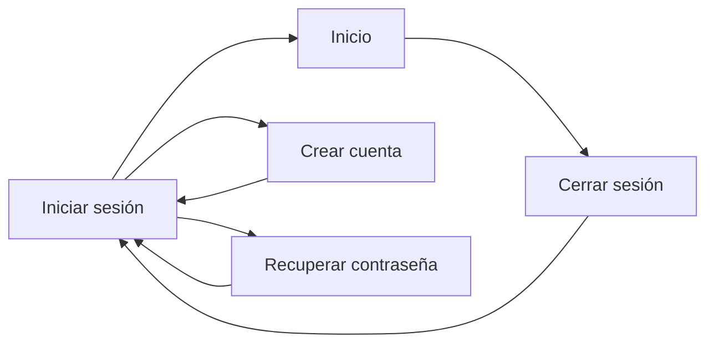

# Arquitectura

El incremento actual contiene una aplicación local de autenticación. La dependencia es `presentation → application → domain`; infraestructura implementa persistencia y seguridad, sin importaciones de Qt en dominio o aplicación.

Implementado además: casos de uso y persistencia de emisores fiscales, establecimientos, horarios, clientes y borradores con `Decimal`; los borradores pueden editarse, descartarse o exportarse a un PDF de composición sin valor fiscal. La interfaz usa una shell con navegación lateral (Inicio, Clientes, Peluquerías, Facturas, Perfil y Ajustes) y Clientes se organiza en pestañas de listado y ficha. La selección de establecimiento activo se conserva por cuenta y el Inicio muestra indicadores reales. Perfil permite editar datos personales y cambiar contraseña tras validar la actual; Ajustes declara de forma explícita sus preferencias aún pendientes. La emisión/numeración y los cobros de facturas emitidas están expresamente fuera de alcance; no existe capa fiscal ni facturación funcional.
