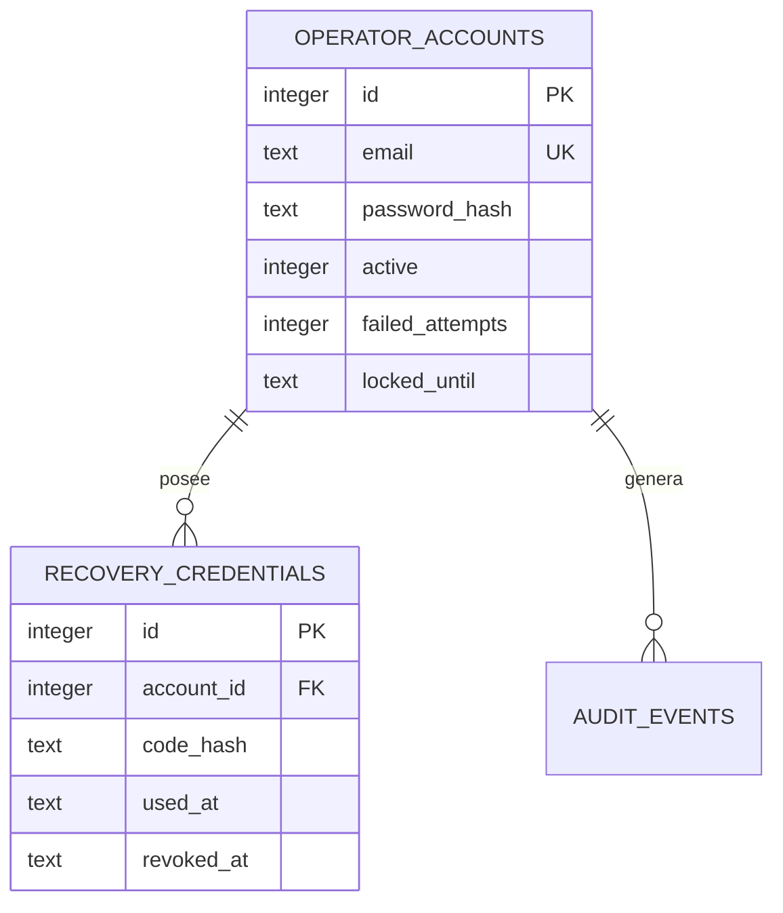

# Modelo de datos (incremento actual)

Migración 1 crea las tres tablas. Restricciones: correo único sin distinción de mayúsculas, claves foráneas activas y un índice `(account_id, created_at)` sobre auditoría. Los eventos no almacenan contraseñas, códigos ni datos personales completos.

La migración 2 añade `LegalEntity`, `Salon`, `OpeningInterval` y `Customer`. Un emisor pertenece a una cuenta y puede compartirse entre varios establecimientos; un establecimiento no puede referenciar emisores de otra cuenta. Los clientes pertenecen a la cuenta, no se duplican por salón y se archivan en vez de eliminarse. Los horarios admiten varios tramos no solapados por día; un día cerrado se representa sin tramos. No se permiten aún cruces de medianoche.

La migración 3 añade `AccountPreferences`: una fila por cuenta que conserva el establecimiento activo. La referencia solo se puede fijar a una peluquería activa que pertenezca a esa cuenta; el caso de uso aplica esa comprobación antes de persistirla.

La migración 5 añade a esas preferencias el idioma (`es-ES` en esta versión), el formato de fecha y la carpeta de exportación. Sus restricciones evitan almacenar formatos o idiomas no soportados.

La migración 4 añade `Invoice` e `InvoiceLine` exclusivamente para **borradores**. Cada borrador queda ligado a cuenta, establecimiento, emisor y cliente de la cuenta y puede incluir una o más líneas. Las cantidades monetarias se almacenan como texto decimal ya redondeado a céntimos; no se usa `float`. Un borrador puede editarse y recalcula y reemplaza atómicamente sus líneas; también puede descartarse, con borrado en cascada de sus líneas. No hay emisión ni documento fiscal en esta fase. El estado fiscal y de cobro sólo admiten `DRAFT` y `PENDING`, por lo que no puede convertirse en una factura emitida.

Pendientes: series, snapshots inmutables al emitir, `Payment`, numeración transaccional y restricciones fiscales de emisión/rectificación. El PDF disponible corresponde únicamente al estado de borrador y no se conserva como documento fiscal.
